# AA-12V 탐사로버 GCS (VER3) 사용 설명서

**PUMPKIN IDEA FACTORY MAKERSPACE · SRC 탐사로버 관제 프로그램**

`Rover_GCS_VER3.html` 하나로 AA-12V 탐사로버를 연결하고, 영상을 보고, 6가지 미션을 수행하고, 데이터를 엑셀로 저장합니다. 설치할 것은 없고, 파일을 브라우저로 열면 바로 실행됩니다.

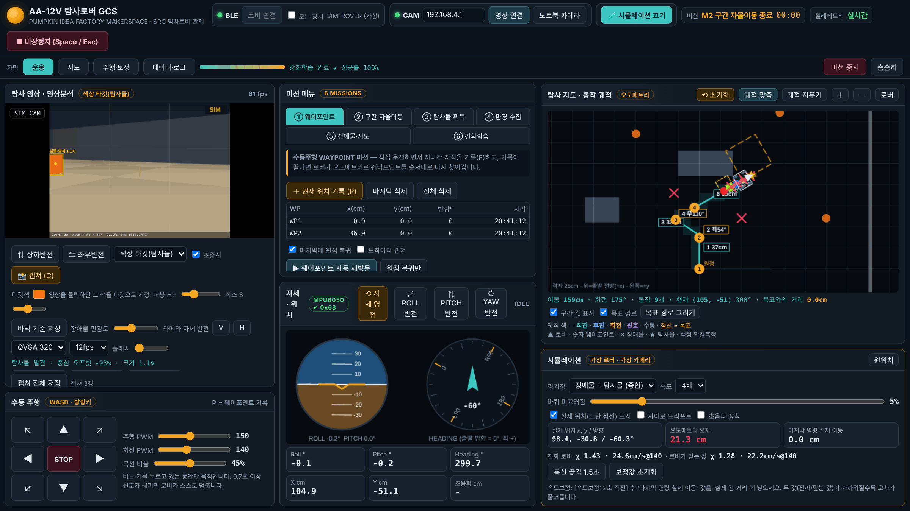

> 이 설명서의 사진은 모두 실제 GCS 를 **🧪 시뮬레이션 모드**로 실행해 찍은 화면입니다. 실제 로버를 연결하면 영상 배지가 `SIM CAM` 대신 `ESP32-CAM` 으로 나오고 시뮬레이션 카드가 없습니다.

---

## 목차

1. [준비물과 실행 환경](#1-준비물과-실행-환경)
2. [5분 빠른 시작](#2-5분-빠른-시작)
3. [화면 구성 한눈에 보기](#3-화면-구성-한눈에-보기)
4. [상단 막대 (연결·비상정지)](#4-상단-막대-연결비상정지)
5. [화면 전환 막대](#5-화면-전환-막대)
6. [카드별 사용방법](#6-카드별-사용방법)
   - [6-1 탐사 영상 · 영상분석](#6-1-탐사-영상--영상분석)
   - [6-2 수동 주행](#6-2-수동-주행)
   - [6-3 미션 메뉴 (6 MISSIONS)](#6-3-미션-메뉴-6-missions)
   - [6-4 오도메트리 주행](#6-4-오도메트리-주행)
   - [6-5 자세 · 위치](#6-5-자세--위치)
   - [6-6 환경 데이터](#6-6-환경-데이터)
   - [6-7 탐사 지도 · 동작 궤적](#6-7-탐사-지도--동작-궤적)
   - [6-8 기하 · 보정](#6-8-기하--보정)
   - [6-9 거리 → 시간 환산](#6-9-거리--시간-환산)
   - [6-10 통신 로그](#6-10-통신-로그)
   - [6-11 시뮬레이션](#6-11-시뮬레이션)
7. [미션별 사용방법](#7-미션별-사용방법)
8. [키보드 단축키](#8-키보드-단축키)
9. [저장되는 파일](#9-저장되는-파일)
10. [처음 한 번 하는 보정 순서](#10-처음-한-번-하는-보정-순서)
11. [문제 해결](#11-문제-해결)
12. [부록: BLE 명령·텔레메트리 형식](#12-부록-ble-명령텔레메트리-형식)

---

## 1. 준비물과 실행 환경

| 항목 | 내용 |
|---|---|
| 브라우저 | **Chrome 또는 Edge** (Windows · macOS · 안드로이드). Web Bluetooth 때문에 Firefox·Safari는 로버 연결이 안 됩니다. |
| 노트북 | 블루투스(BLE)와 Wi-Fi가 모두 있어야 합니다. |
| 로버 | Arduino Nano + HM-10(BLE) + L298N + MPU6050 + BME280 + ESP32-CAM, 최신 나노 펌웨어 |
| 카메라 | ESP32-CAM 팀 AP 모드 — Wi-Fi 이름 `PUMPKIN-CAM-팀번호`, 비밀번호 `pumpkin팀번호`, 주소 `192.168.4.1` |
| 인터넷 | 필요 없습니다. 엑셀 저장 라이브러리가 파일 안에 들어 있습니다. |

> 통신 구조: **로버 제어·센서 데이터는 BLE(HM-10)**, **영상만 Wi-Fi(ESP32-CAM)** 로 받습니다. 그래서 노트북은 카메라 Wi-Fi에 붙어 있어도 블루투스로 로버를 조종할 수 있습니다.

---

## 2. 5분 빠른 시작

1. 로버 전원을 켭니다. (ESP32-CAM 부팅까지 5초 정도 기다립니다.)
2. 노트북 Wi-Fi를 우리 팀 **`PUMPKIN-CAM-팀번호`** 에 접속합니다.
3. `Rover_GCS_VER3.html` 을 Chrome/Edge로 엽니다.
4. 상단 **[로버 연결]** → 목록에서 `PUMPKIN-팀번호`(또는 HM-10 이름) 선택 → 초록 불 확인.
5. 상단 **[영상 연결]** → 영상이 나오는지 확인.
6. 자세·위치 카드의 **[⟲ 자세 영점]** → 2초간 로버를 건드리지 않습니다.
7. **수동 주행**(WASD/방향키)으로 움직여 보고, 미션 탭을 골라 시작합니다.
8. 끝나면 **④ 환경 수집 → [📊 엑셀 내보내기]** 로 데이터를 저장합니다.

> 로버 없이 연습하려면 4번 대신 상단 **[🧪 시뮬레이션]** 을 누르세요. 가상 로버와 가상 카메라로 모든 미션을 똑같이 해 볼 수 있습니다.

---

## 3. 화면 구성 한눈에 보기

화면은 위에서부터 **상단 막대 → 화면 전환 막대 → 카드 3열** 로 되어 있습니다.

페이지 전체는 스크롤되지 않습니다. 내용이 넘치면 **그 열만** 안에서 스크롤됩니다.

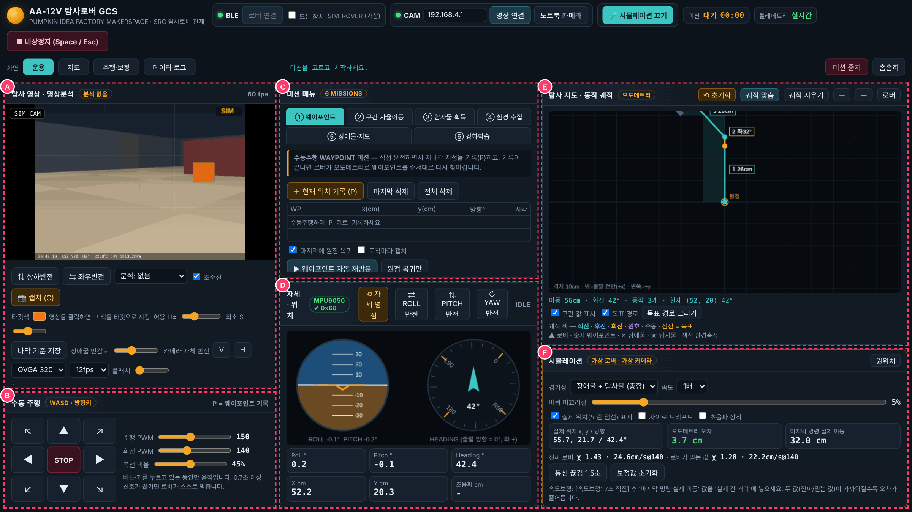

| 표시 | 카드 | 설명 위치 |
|---|---|---|
| A | 탐사 영상 · 영상분석 | [6-1](#6-1-탐사-영상--영상분석) |
| B | 수동 주행 | [6-2](#6-2-수동-주행) |
| C | 미션 메뉴 | [6-3](#6-3-미션-메뉴-6-missions), [7](#7-미션별-사용방법) |
| D | 자세 · 위치 | [6-5](#6-5-자세--위치) |
| E | 탐사 지도 · 동작 궤적 | [6-7](#6-7-탐사-지도--동작-궤적) |
| F | 시뮬레이션 (켰을 때만) | [6-11](#6-11-시뮬레이션) |

### 화면(뷰)별 카드 배치

| 화면 | 단축키 | 1열 | 2열 | 3열 | 이럴 때 씁니다 |
|---|---|---|---|---|---|
| **운용** | `1` | 탐사 영상, 수동 주행 | 미션 메뉴, 자세·위치 | 탐사 지도, (시뮬레이션) | 대회·미션 수행 기본 화면 |
| **지도** | `2` | 탐사 지도 (크게) | 자세·위치, 환경 데이터 | — | 궤적·장애물·지도 확인, 발표 |
| **주행·보정** | `3` | 수동 주행, 오도메트리 주행 | 기하·보정, 거리→시간 환산 | (시뮬레이션), 자세·위치 | 처음 조립 후 보정 작업 |
| **데이터·로그** | `4` | 환경 데이터 | 미션 메뉴 | 통신 로그 | 데이터 확인·엑셀 저장, 고장 진단 |

마지막에 보던 화면은 기억되어 다음에 열 때 그대로 나옵니다.

**지도 화면 (`2`)** — 지도를 크게 보면서 자세·환경값을 함께 봅니다.

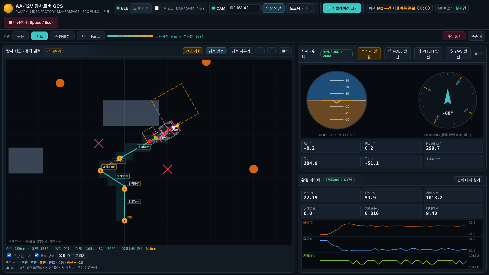

**주행·보정 화면 (`3`)** — 조립 후 보정 작업을 한 화면에서 합니다.

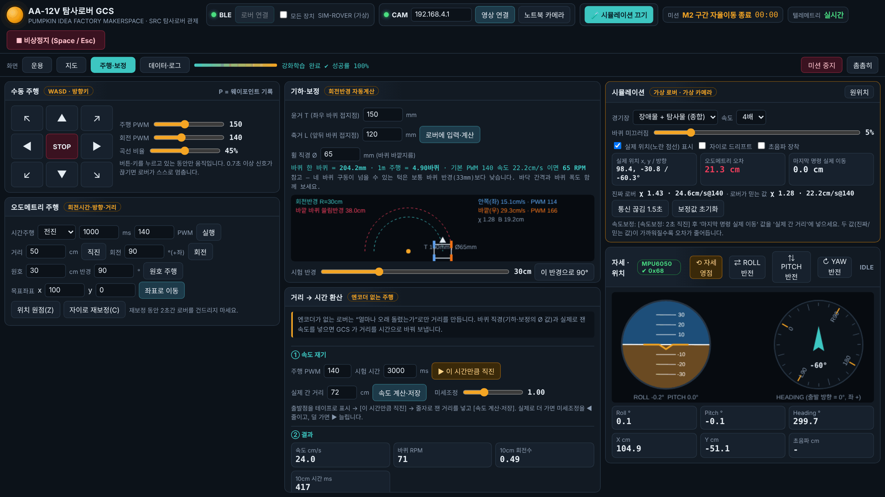

**데이터·로그 화면 (`4`)** — 환경 그래프, 미션 표, 통신 로그를 나란히 봅니다.

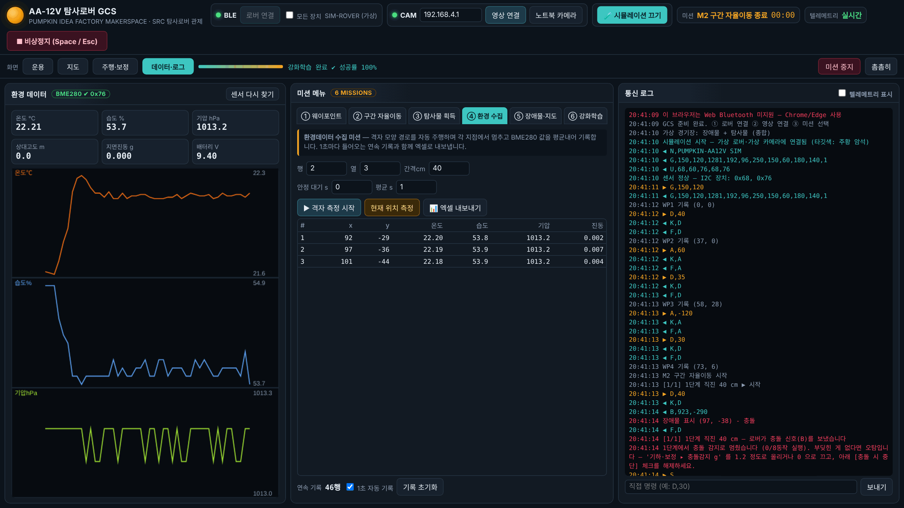

---

## 4. 상단 막대 (연결·비상정지)

| 번호 | 영역 |
|---|---|
| ① | 로고·프로그램 이름 |
| ② | BLE 로버 연결 |
| ③ | CAM 영상 연결 |
| ④ | 시뮬레이션 |
| ⑤ | 미션 이름·타이머 |
| ⑥ | 텔레메트리 수신 상태 |
| ⑦ | 비상정지 |

| 요소 | 사용방법 |
|---|---|
| **BLE · [로버 연결]** | 누르면 블루투스 장치 목록이 뜹니다. `PUMPKIN-`, `HM`, `BT05`, `MLT`, `JDY` 로 시작하는 이름만 보입니다. 연결되면 점이 초록색, 버튼이 **[연결 해제]** 로 바뀝니다. |
| **☐ 모든 장치** | 목록에 로버가 안 보이면 체크하고 다시 [로버 연결]. 이름이 다른 BLE 모듈도 모두 보여 줍니다. |
| **CAM · IP 입력칸** | 기본값 `192.168.4.1` (팀 AP 모드). 핫스팟 모드로 쓰면 시리얼 모니터에 나온 IP를 넣습니다. 입력한 IP는 기억됩니다. |
| **[영상 연결]** | `http://IP:81/stream` 영상을 받습니다. 연결 중이면 점이 노란색, 영상이 오면 초록색. |
| **[노트북 카메라]** | 로버 없이 노트북 웹캠으로 영상분석(색 타깃, 움직임 등)을 연습합니다. |
| **[🧪 시뮬레이션]** | 가상 로버·가상 카메라를 켭니다. 켜져 있는 동안은 실제 로버 연결이 막힙니다. 다시 누르면 꺼집니다. |
| **미션 / 타이머** | 지금 진행 중인 미션 이름과 경과 시간(분:초). |
| **텔레메트리** | 로버 데이터가 얼마 전에 왔는지. `실시간`(초록) = 정상, `3s 전`(빨강) = 통신이 끊기고 있음. |
| **■ 비상정지** | 모든 동작·미션을 즉시 멈춥니다. 키보드 **Space** 또는 **Esc** (글자 입력칸에 커서가 있어도 Esc는 항상 작동). |

---

## 5. 화면 전환 막대

① 화면 버튼 4개 · ② 진행 막대 · ③ 상태글 · ④ 미션 중지 · ⑤ 촘촘히

| 요소 | 사용방법 |
|---|---|
| **[운용] [지도] [주행·보정] [데이터·로그]** | 화면 배치를 바꿉니다. 숫자키 `1`~`4` 로도 바뀝니다. |
| **진행 막대** | 미션 진행률. |
| **상태글** | 미션이 지금 무엇을 하는지, 끝났을 때 결과·실패 이유를 보여 줍니다. |
| **[미션 중지]** | 진행 중인 미션만 멈춥니다. (비상정지와 같은 효과로 로버도 멈춤) |
| **[촘촘히]** | 글자·여백을 줄여 더 많이 보이게 합니다. 화면 세로가 900px보다 작으면 자동으로 켜지고, 한 번 직접 누르면 그 뒤로는 수동으로만 바뀝니다. |

---

## 6. 카드별 사용방법

### 6-1 탐사 영상 · 영상분석

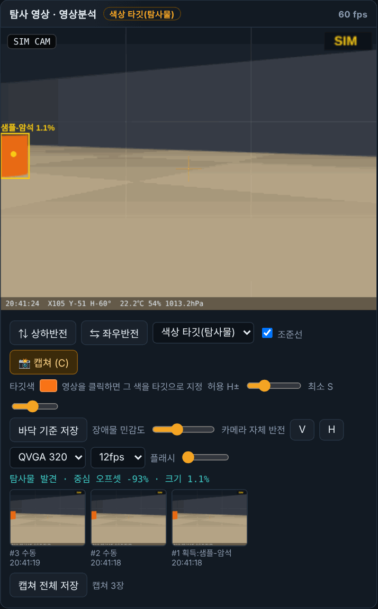
▲ 탐사 영상 카드 — 색상 타깃 분석으로 주황 탐사물을 찾은 모습

ESP32-CAM 영상을 보고, 분석하고, 사진을 남기는 카드입니다. 오른쪽 위에 초당 프레임(fps)이 보이고, 영상 왼쪽 위 배지에 영상 출처(`ESP32-CAM` / `WEBCAM` / `SIM CAM`)가 표시됩니다. 영상 아래 띠에는 시각, 로버 좌표·방향, 온도·습도가 겹쳐 나옵니다.

**첫째 줄 — 보기·분석·캡쳐**

| 요소 | 사용방법 |
|---|---|
| **⇅ 상하반전 / ⇆ 좌우반전** | 화면에서만 영상을 뒤집습니다. 카메라를 거꾸로 달았을 때 사용. (영상분석도 뒤집힌 화면 기준) |
| **분석 선택** | `없음` · `색상 타깃(탐사물)` · `장애물(바닥) 감지` · `움직임 감지` · `윤곽선(엣지)` · `밝기·노출 분석` |
| **☑ 조준선** | 화면 가운데 십자선과 3×3 격자. |
| **📸 캡쳐 (C)** | 지금 화면을 사진으로 남깁니다. 키보드 `C`. 좌표·환경값·미션 이름이 함께 기록됩니다. |

**분석 모드별 설명**

| 모드 | 무엇을 보나 | 결과 표시 |
|---|---|---|
| 색상 타깃 | 지정한 색과 비슷한 픽셀 덩어리 | 노란 사각형 + 중심점, "중심 오프셋 %, 크기 %" |
| 장애물(바닥) | 로버 앞 사다리꼴 바닥 영역이 저장한 바닥색과 얼마나 다른지 | 사다리꼴 초록(안전)/빨강(장애물), 가장 가까운 장애물 줄 |
| 움직임 감지 | 앞 프레임과 달라진 픽셀 | 움직인 곳에 빨간 원 |
| 윤곽선(엣지) | 소벨 필터로 경계선 추출 | 윤곽 밀도 % (지형이 복잡할수록 높음) |
| 밝기·노출 | 밝기 분포 | 히스토그램, 평균 밝기 (50 미만이면 "플래시를 켜세요") |

**둘째 줄 — 타깃 색 설정**

| 요소 | 사용방법 |
|---|---|
| **영상 클릭** | 클릭한 곳의 색을 탐사물 색으로 지정하고 분석을 자동으로 `색상 타깃`으로 바꿉니다. |
| **타깃색 견본** | 지정된 색을 보여 줍니다. (기본: 주황) |
| **허용 H±** | 색상(Hue) 허용 범위. 탐사물을 못 찾으면 늘리고, 엉뚱한 것을 잡으면 줄입니다. |
| **최소 S** | 채도 최소값. 회색 바닥·벽까지 잡히면 올립니다. |

**셋째 줄 — 장애물·카메라 설정**

| 요소 | 사용방법 |
|---|---|
| **[바닥 기준 저장]** | 장애물이 없는 바닥을 비춘 상태에서 누릅니다. 이 색을 기준으로 장애물을 판단합니다. |
| **장애물 민감도** | 높일수록 작은 색 차이도 장애물로 봅니다. |
| **카메라 자체 반전 [V] [H]** | ESP32-CAM 자체 설정으로 상하(vflip)·좌우(hmirror)를 바꿉니다. 원본 캡쳐까지 바뀝니다. |
| **해상도** | QVGA 320(기본) · CIF 400 · VGA 640. 여러 팀이 함께 쓰면 QVGA를 권장. |
| **fps** | 5~20. 여러 팀이면 10~12. |
| **플래시** | 0~255. ESP32-CAM LED 밝기. 어두운 곳에서 사용. |

**아래 — 캡쳐 갤러리**

- 찍은 사진이 썸네일로 쌓입니다. **썸네일을 클릭하면 그 사진 1장을 저장**합니다.
- **[캡쳐 전체 저장]** 은 모든 사진을 차례로 내려받습니다. 파일명은 `PUMPKIN_날짜_시각_번호.jpg`.

> 영상분석이 안 되고 "CORS 허용이 없습니다"가 뜨면 ESP32-CAM 코드가 예전 버전입니다. 최신 CAM 코드를 올리세요.

---

### 6-2 수동 주행

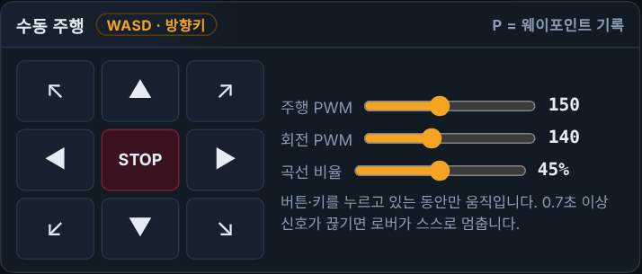
▲ 수동 주행 카드

| 요소 | 사용방법 |
|---|---|
| **방향 패드 (8방향 + STOP)** | **누르고 있는 동안만** 움직입니다. 대각선(↖↗↙↘)은 곡선 주행, ◀▶는 제자리 회전. **STOP** 은 비상정지와 같습니다. |
| **키보드** | `W`/`↑` 전진, `S`/`↓` 후진, `A`/`←` 좌회전, `D`/`→` 우회전. 두 키를 함께 누르면 곡선 주행. |
| **주행 PWM** (70~255) | 전진·후진 속도. |
| **회전 PWM** (70~255) | 제자리 회전 속도. |
| **곡선 비율** (0~90%) | 대각선 주행 시 안쪽 바퀴를 얼마나 늦출지. 클수록 급하게 꺾입니다. |
| **P 키** | 지금 위치를 웨이포인트로 기록 (① 웨이포인트 미션용). |

> 안전 기능: 0.7초 이상 신호가 끊기면 로버가 스스로 멈춥니다. 브라우저 창에서 포커스가 빠져도 즉시 멈춥니다. 미션이 진행 중일 때는 수동 주행이 무시됩니다.

---

### 6-3 미션 메뉴 (6 MISSIONS)

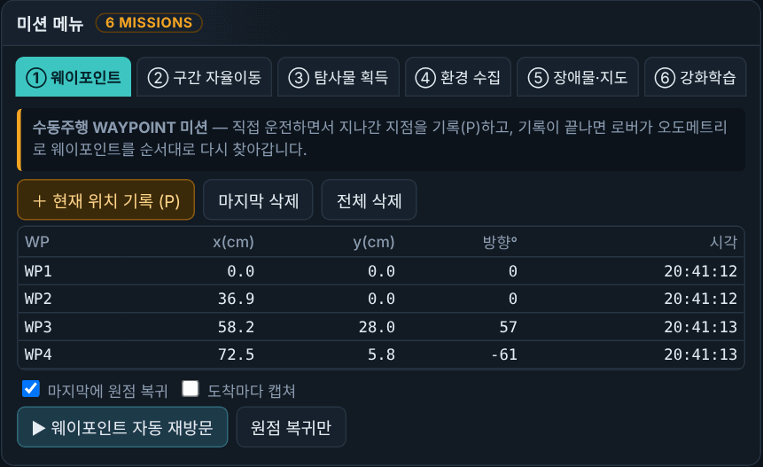
▲ 미션 메뉴 카드 — 위쪽 탭으로 미션을 고릅니다

탭을 눌러 미션을 고르면 아래에 그 미션의 설정과 버튼이 나옵니다. 각 미션의 자세한 사용방법은 [7. 미션별 사용방법](#7-미션별-사용방법)에 있습니다.

| 탭 | 미션 |
|---|---|
| ① 웨이포인트 | 수동으로 운전하며 기록한 지점을 자동으로 다시 찾아가기 |
| ② 구간 자율이동 | 직진·회전·원호·시간주행·대기 단계를 이어 만든 경로를 자율 수행 |
| ③ 탐사물 획득 | 영상에서 색으로 탐사물을 찾아 접근하고 사진으로 획득 |
| ④ 환경 수집 | 격자 경로를 돌며 지점마다 온도·습도·기압을 평균 측정, 엑셀 저장 |
| ⑤ 장애물·지도 | 장애물을 피하며 돌아다니고 지도 작성 |
| ⑥ 강화학습 | 시뮬레이터에서 Q-learning으로 박스를 도는 길을 학습해 로버에 실행 |

> 모든 미션은 **로버(또는 시뮬레이션)가 연결되어 있어야** 시작됩니다. 한 번에 하나의 미션만 진행됩니다.

---

### 6-4 오도메트리 주행

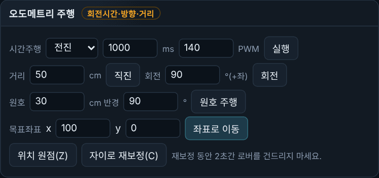
▲ 오도메트리 주행 카드

로버에 명령을 한 번씩 직접 보내는 카드입니다. 보정 확인이나 짧은 시험 주행에 씁니다.

| 줄 | 사용방법 |
|---|---|
| **시간주행** | 방향(전진/후진/좌회전/우회전), 시간(ms), PWM 을 넣고 [실행]. 거리와 상관없이 그 시간만큼 움직입니다. |
| **거리 / 회전** | 거리(cm) → [직진] (음수 = 후진). 각도(°) → [회전] (**양수 = 왼쪽**, 음수 = 오른쪽). |
| **원호** | 반경(cm)과 각도(°)를 넣고 [원호 주행]. 회전반경은 기하·보정 값으로 계산됩니다. |
| **목표좌표** | x, y(cm) 를 넣고 [좌표로 이동]. 방향을 맞춘 뒤 직진하고, 오차가 남으면 최대 3번 다시 겨냥합니다. |
| **[위치 원점(Z)]** | 지금 자리를 (0,0)으로. |
| **[자이로 재보정(C)]** | 자이로 영점을 다시 잡습니다. **2초간 로버를 건드리지 마세요.** |

> 좌표계: 영점을 잡을 때 로버가 보고 있던 방향이 **+x**, 왼쪽이 **+y** 입니다.

---

### 6-5 자세 · 위치

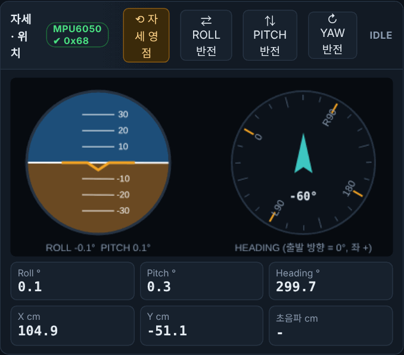
▲ 자세·위치 카드

MPU6050 기울기와 오도메트리 위치를 보여 줍니다. 제목 옆 태그에 센서 상태(`MPU6050 ✔ 68` 또는 `MPU6050 없음`)가 표시됩니다.

| 요소 | 사용방법 |
|---|---|
| **자세 그림** | 인공 수평선 형태로 Roll·Pitch, 나침반으로 방향(Heading)을 그립니다. |
| **값 6칸** | Roll°, Pitch°, Heading°, X cm, Y cm, 초음파 cm(초음파를 달았을 때만). |
| **[⟲ 자세 영점]** | 자이로 재보정(C) → 2.6초 뒤 위치 원점(Z) 을 한 번에. 궤적도 지웁니다. **미션 시작 전에 항상 누르세요.** |
| **[⇄ ROLL 반전]** | 좌우 기울기 표시 방향을 반대로. MPU6050을 반대로 달았을 때. (화면 표시만 바뀌고 기억됩니다) |
| **[⇅ PITCH 반전]** | 앞뒤 기울기 표시 방향을 반대로. |
| **[↻ YAW 반전]** | 로버 펌웨어의 회전 부호를 바꿉니다(`Y` 명령). 왼쪽으로 돌았는데 Heading이 줄어들면 누르세요. Heading·지도·자율주행 회전이 모두 함께 바뀝니다. **로버가 연결된 상태에서만** 됩니다. |
| **모드 글자** | 로버의 현재 동작 상태: `IDLE` `MANUAL` `TIMED` `DIST` `TURN` `ARC` `CALIB` |

---

### 6-6 환경 데이터

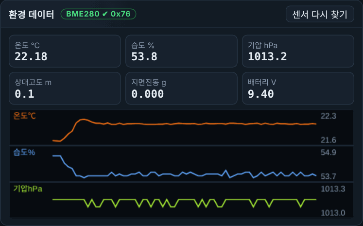
▲ 환경 데이터 카드

| 요소 | 사용방법 |
|---|---|
| **값 6칸** | 온도 ℃, 습도 %, 기압 hPa, 상대고도 m(시작 지점 기준), 지면진동 g, 배터리 V(배터리 측정을 켰을 때). |
| **그래프** | 최근 환경값 변화를 그립니다. |
| **BME280 태그** | `BME280 ✔ 76` 정상 / `BMP280 · 습도 없음`(노란색, 습도 센서가 없는 칩) / `BME280 없음` |
| **[센서 다시 찾기]** | 배선을 고친 뒤 로버를 껐다 켜지 않고 I2C 센서를 다시 찾습니다. **2초간 로버를 움직이지 마세요.** 결과와 배선 점검 안내가 통신 로그에 나옵니다. |

---

### 6-7 탐사 지도 · 동작 궤적

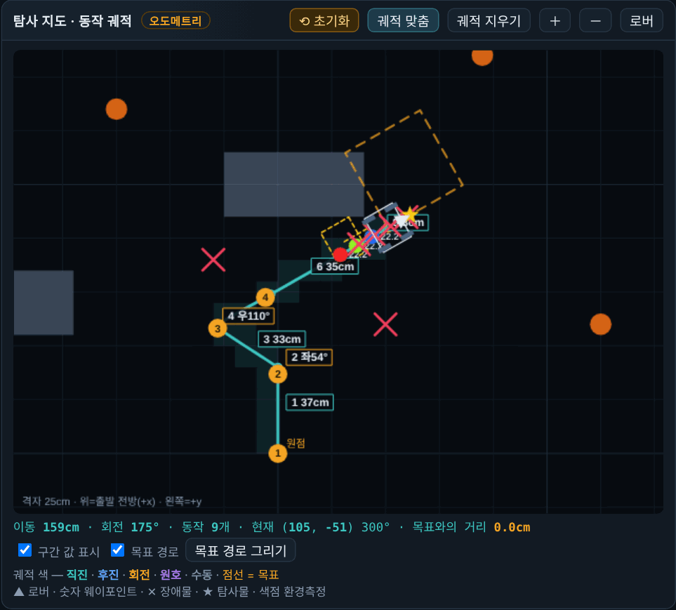
▲ 탐사 지도 카드 — 웨이포인트, 정사각형 경로, 장애물(✕), 탐사물(★), 측정점

로버가 지나간 길, 웨이포인트, 장애물, 탐사물, 측정 지점을 한 장의 지도로 보여 줍니다. 지도는 **위쪽이 +x(처음 보던 방향), 왼쪽이 +y** 입니다.

**제목줄 버튼**

| 버튼 | 사용방법 |
|---|---|
| **[⟲ 초기화]** | 경로·궤적·장애물·웨이포인트·탐사물·측정지점을 모두 지우고 **지금 자리를 원점**으로 합니다. (로버에도 Z를 보냅니다) |
| **[궤적 맞춤]** | 궤적 전체가 보이도록 배율을 맞춥니다. 미션이 끝나면 자동으로 맞춰집니다. |
| **[궤적 지우기]** | 궤적 선만 지웁니다. 장애물·웨이포인트는 남습니다. |
| **[＋] [－]** | 확대·축소. 마우스 휠로도 됩니다. |
| **[로버]** | 로버가 화면 가운데 오게 합니다. |
| **드래그** | 지도를 끌어 이동합니다. |

**아래 설정**

| 요소 | 사용방법 |
|---|---|
| **상태 글** | 구간 수, 총 이동거리·회전량 등 궤적 요약. |
| **☑ 구간 값 표시** | 각 구간 시작점에 번호와 값(예: 직진 50cm, 회전 90°)을 적습니다. |
| **☑ 목표 경로** | ② 구간 자율이동 단계를 고칠 때마다 예상 경로를 점선으로 다시 그립니다. |
| **[목표 경로 그리기]** | ② 에 넣은 단계대로 지금 위치에서 갈 예상 경로를 그립니다. 실제 궤적과 비교해 보정이 맞는지 봅니다. |

**지도 기호**

| 기호·색 | 뜻 |
|---|---|
| ▲ | 로버 (크기는 기하·보정의 윤거·축거로 그림) |
| 숫자 | 웨이포인트 |
| ✕ | 장애물 |
| ★ | 탐사물 |
| 색점 | 환경 측정 지점 (온도에 따라 색) |
| 청록 선 | 직진 |
| 파란 선 | 후진 |
| 주황 선 | 회전 |
| 보라 선 | 원호 |
| 회색 선 | 수동 주행 |
| 주황 점선 | 목표(예상) 경로 |

---

### 6-8 기하 · 보정

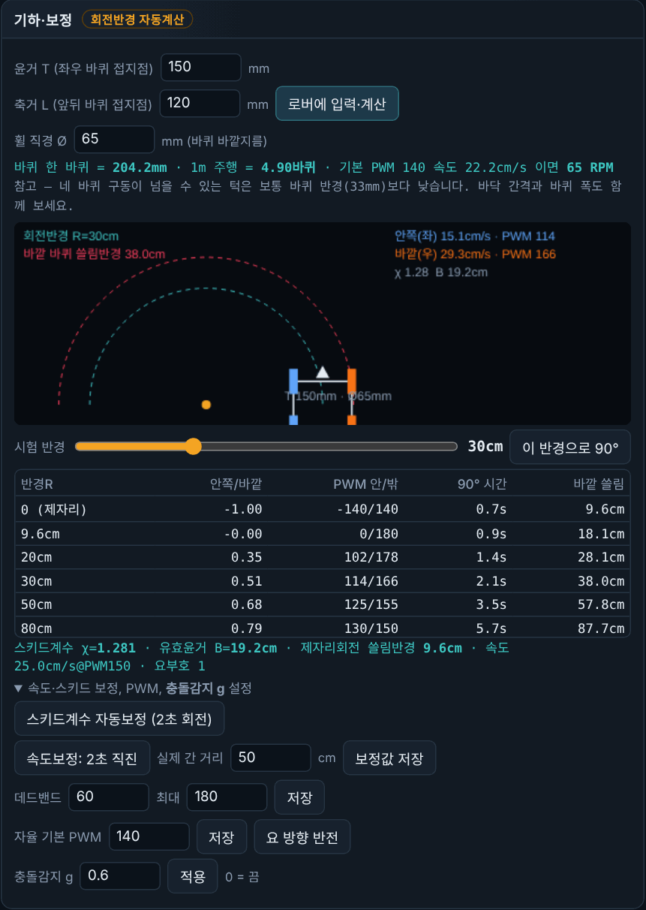
▲ 기하·보정 카드 (접힌 메뉴를 펼친 상태)

바퀴 접지점 거리로 회전반경을 계산하고, 속도·PWM·충돌감지를 보정하는 카드입니다.

**기본 입력**

| 요소 | 사용방법 |
|---|---|
| **윤거 T** (mm) | 왼쪽·오른쪽 바퀴가 바닥에 닿는 점 사이 거리. 자로 재서 넣습니다. |
| **축거 L** (mm) | 앞·뒤 바퀴가 바닥에 닿는 점 사이 거리. |
| **[로버에 입력·계산]** | T·L 을 로버로 보내(`G` 명령) 스키드 계수 χ, 유효 윤거 B 등을 계산하게 합니다. 결과가 아래 표에 나옵니다. |
| **휠 직경 Ø** (mm) | 바퀴 바깥지름. 거리→시간 환산과 지도 그림에 쓰입니다. 범위를 벗어나면 빨간 경고. |
| **휠 요약 글** | 바퀴 둘레, 회전수 등 요약. |
| **기하 그림** | 로버를 위에서 본 그림과 선택한 반경의 원호. |
| **시험 반경 슬라이더 + [이 반경으로 90°]** | 0~100cm 반경을 골라 실제로 90° 원호를 돌아 봅니다. |
| **회전반경 표** | 반경 R 별 안쪽/바깥 바퀴 속도 비, PWM 안/밖, 90° 걸리는 시간, 바깥 바퀴 쓸림. |

> 바퀴가 4개인 스키드 조향은 제자리에서 돌 때 바퀴가 옆으로 미끄러집니다. 그래서 실제 회전은 윤거보다 넓은 **유효 윤거 B = χ·T** (χ ≈ 1+(L/T)²) 로 계산합니다.

**접힌 메뉴 "속도·스키드 보정, PWM, 충돌감지 g 설정"** (눌러서 펼칩니다)

| 요소 | 사용방법 |
|---|---|
| **[스키드계수 자동보정 (2초 회전)]** | 로버가 2초간 제자리 회전하며 자이로로 χ 를 실측합니다. **두 번 눌러야 실행**됩니다 (첫 번째: "주변을 비우고 한 번 더"). |
| **[속도보정: 2초 직진]** | 2초간 직진합니다. 역시 두 번 눌러 실행 ("출발점 표시 후 한 번 더"). |
| **실제 간 거리 + [보정값 저장]** | 줄자로 잰 거리(cm)를 넣고 저장하면 로버의 속도 모델이 고쳐집니다(`V` 명령). |
| **데드밴드 / 최대 + [저장]** | 모터가 움직이기 시작하는 최소 PWM, 최대 PWM (`W` 명령). |
| **자율 기본 PWM + [저장]** | 자율주행 때 쓰는 기본 속도 (`P` 명령). |
| **[요 방향 반전]** | 자세·위치 카드의 [↻ YAW 반전] 과 같은 기능. |
| **충돌감지 g + [적용]** | MPU6050 충격이 이 값을 넘으면 충돌(`B`)로 판단합니다. **0 = 끔.** 부딪히지 않았는데 미션이 자꾸 멈추면 1.0~1.2로 올리세요. |

---

### 6-9 거리 → 시간 환산

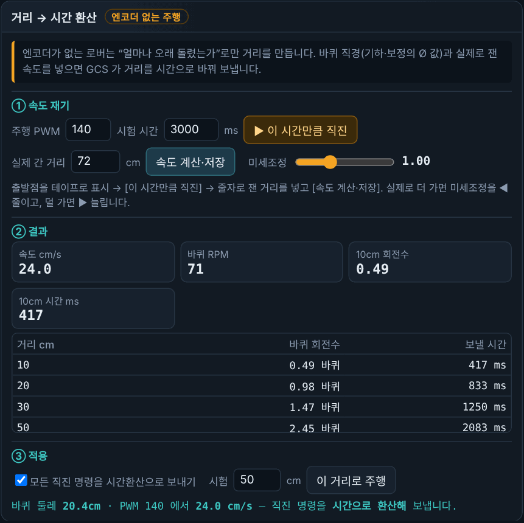
▲ 거리→시간 환산 카드

엔코더가 없는 로버는 "얼마나 오래 돌렸는가"로만 거리를 만듭니다. 실제 속도를 재 두면 GCS가 **모든 직진 명령을 시간으로 바꿔** 보냅니다.

| 단계 | 사용방법 |
|---|---|
| **① 속도 재기** | 주행 PWM, 시험 시간(ms)을 넣고 **[▶ 이 시간만큼 직진]** → 줄자로 잰 거리를 **실제 간 거리**에 넣고 **[속도 계산·저장]**. |
| **미세조정** | 실제로 더 가면 ◀ 로 줄이고, 덜 가면 ▶ 로 늘립니다 (0.50~2.00배). |
| **② 결과** | 속도 cm/s, 바퀴 RPM, 10cm 회전수, 10cm 시간 ms, 거리별(10~200cm) 보낼 시간 표. |
| **③ 적용** | **☑ 모든 직진 명령을 시간환산으로 보내기** — 켜면 미션·좌표이동의 직진이 `D,거리` 대신 `T,F,시간,PWM` 으로 나갑니다. **시험 cm + [이 거리로 주행]** 으로 확인합니다. |

> 휠 직경은 기하·보정의 Ø 값을 그대로 씁니다. 측정값은 저장되어 다음에 열 때도 유지됩니다.

---

### 6-10 통신 로그

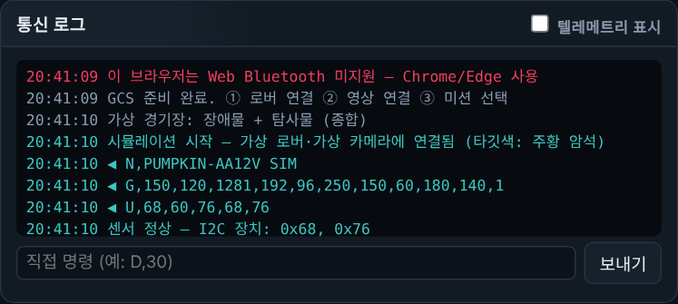
▲ 통신 로그 카드 (맨 위 빨간 줄은 사진을 찍은 프로그램에 블루투스가 없어서 나온 것으로, Chrome/Edge 에서는 나오지 않습니다)

| 요소 | 사용방법 |
|---|---|
| **로그 창** | `▶` 보낸 명령(주황), `◀` 받은 응답(청록), 시스템 안내(회색), 오류(빨강). 최근 300줄을 보관합니다. |
| **☐ 텔레메트리 표시** | 켜면 1초에 여러 번 오는 자세(`I`)·환경(`E`) 줄과 수동 주행 명령(`M`)까지 모두 보여 줍니다. 평소엔 꺼 두세요. |
| **직접 명령 + [보내기]** | 로버 명령을 직접 입력합니다. 예) `D,30`, `A,-90`, `Q`. Enter 키로도 보냅니다. 명령 목록은 [부록](#12-부록-ble-명령텔레메트리-형식) 참고. |

> 나노 펌웨어가 I2C 센서를 자동 복구하면 `N,I2C RECOVER #번호 원인 ...` 줄이 찍힙니다. 이 줄이 자주 보이면 배선이 불안정하다는 뜻입니다.

---

### 6-11 시뮬레이션

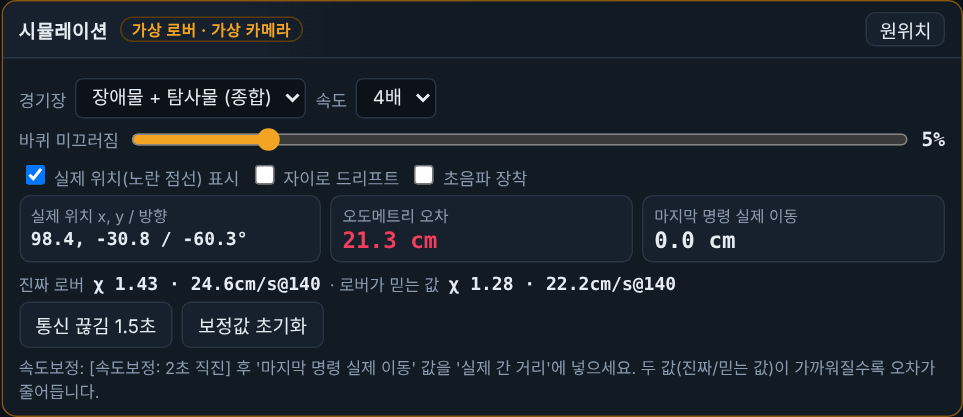
▲ 시뮬레이션 카드

상단 **[🧪 시뮬레이션]** 을 누르면 나타납니다. 가상 펌웨어가 실제 로버와 같은 명령·응답을 주고받기 때문에 **모든 미션과 보정을 로버 없이** 연습할 수 있습니다.

| 요소 | 사용방법 |
|---|---|
| **[원위치]** | 가상 로버를 출발점으로 되돌립니다. |
| **경기장** | 장애물+탐사물(종합) · 빈 바닥(보정 연습) · 탐사물 3개(미션 ③) · 장애물 코스(미션 ⑤) · 미로+목표 암석 |
| **속도** | 1배 · 2배 · 4배 |
| **바퀴 미끄러짐** | 0~30%. 실제 바닥처럼 오차가 생기게 합니다. |
| **☑ 실제 위치(노란 점선) 표시** | 가상 로버의 "진짜" 위치를 지도에 함께 그립니다. 오도메트리 위치와 비교해 보세요. |
| **☐ 자이로 드리프트** | 자이로가 조금씩 틀어지는 현상을 흉내 냅니다. |
| **☐ 초음파 장착** | 가상 초음파 센서를 답니다. |
| **실제 위치 / 오도메트리 오차 / 마지막 명령 실제 이동** | 오차가 6cm 이하 초록, 15cm 넘으면 빨강. |
| **진짜 로버 · 로버가 믿는 값** | 가상 로버의 실제 χ·속도와, 보정으로 로버가 알고 있는 값. 보정을 잘할수록 두 값이 가까워집니다. |
| **[통신 끊김 1.5초]** | 통신이 끊긴 상황을 만들어 안전 정지를 확인합니다. |
| **[보정값 초기화]** | 가상 로버의 보정값을 공장 초기값으로 되돌립니다. |

> 보정 연습 방법: [속도보정: 2초 직진] 을 한 뒤 '마지막 명령 실제 이동' 값을 '실제 간 거리' 칸에 넣고 [보정값 저장]. 실제 로버에서는 줄자로 잰 값을 넣으면 됩니다.

---

## 7. 미션별 사용방법

### 공통 — 시작 전 체크리스트

1. 로버 연결(초록 불), 텔레메트리 `실시간` 확인
2. 로버를 출발점에 놓고 **[⟲ 자세 영점]** (2초간 손대지 않기)
3. 필요하면 지도 **[⟲ 초기화]**
4. 미션 진행 중에는 상단 **미션/타이머**, 화면 전환 막대의 **진행 막대·상태글**을 봅니다.
5. 멈추려면 **[미션 중지]**, 위험하면 **Space/Esc(비상정지)**.

미션이 실패로 끝나면 상태글에 **이유**(충돌 감지, 완료 신호 없음, 연결 끊김 등)가 나옵니다.

---

### ① 웨이포인트 — 수동주행 WAYPOINT 미션

▲ ① 웨이포인트 탭 — 4개 지점을 기록한 상태

직접 운전하며 지나간 지점을 기록하고, 로버가 그 지점들을 순서대로 자동으로 다시 찾아갑니다.

| 요소 | 사용방법 |
|---|---|
| **[＋ 현재 위치 기록 (P)]** | 지금 위치를 웨이포인트로 추가. 키보드 `P` 로도 됩니다. |
| **[마지막 삭제] / [전체 삭제]** | 웨이포인트 지우기. |
| **표** | WP 번호, x·y(cm), 방향°, 기록 시각. |
| **☑ 마지막에 원점 복귀** | 마지막 웨이포인트 다음에 (0,0)으로 돌아옵니다. |
| **☐ 도착마다 캡쳐** | 웨이포인트에 도착할 때마다 사진을 찍습니다. |
| **[▶ 웨이포인트 자동 재방문]** | 미션 시작. |
| **[원점 복귀만]** | (0,0)으로만 돌아갑니다. |

**순서**
1. 출발점에서 [⟲ 자세 영점].
2. 수동 주행(WASD)으로 움직이며 기억할 지점마다 `P`.
3. 로버를 출발점으로 가져다 놓거나 그대로 두고 **[▶ 웨이포인트 자동 재방문]**.
4. 로그에 지점마다 도착 오차(cm)가 기록됩니다.

> 가는 도중 충돌이 감지되면 그 자리에 장애물을 표시하고 멈춥니다.

---

### ② 구간 자율이동 — 정해진 구간 이동 미션

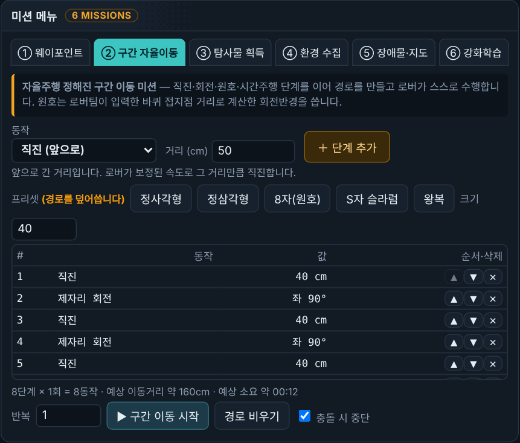
▲ ② 구간 자율이동 탭 — 정사각형 프리셋

동작 단계를 이어 경로를 만들고, 로버가 스스로 수행합니다.

**단계 추가**

| 동작 | 입력 칸 | 설명 |
|---|---|---|
| 직진 | 거리(cm) | 보정된 속도로 앞으로 |
| 후진 | 거리(cm) | 뒤로 (내부적으로 음수 거리) |
| 제자리 회전 | 각도(°) | 양수 = 왼쪽, 음수 = 오른쪽. 예) `-90` 은 우회전 90° |
| 원호 주행 | 반경(cm), 각도(°) | 반경은 1cm 이상, 각도 양수 = 왼쪽으로 휨 |
| 시간주행 | 방향, 시간(ms) | 거리와 무관하게 정해진 시간. PWM은 '자율 기본 PWM' |
| 대기 | 시간(ms) | 멈춰서 기다림 (사진·센서 안정화용) |

동작을 고르면 필요한 칸만 나타나고, 아래에 설명(힌트)이 나옵니다. 값을 넣고 **[＋ 단계 추가]**. 동작마다 마지막에 넣은 값을 기억합니다.

**프리셋** (주의: 지금 경로를 **덮어씁니다**) — `크기` 값을 기준으로 만듭니다.

| 프리셋 | 만들어지는 경로 |
|---|---|
| 정사각형 | (직진 크기 → 좌 90°) × 4 |
| 정삼각형 | (직진 크기 → 좌 120°) × 3 |
| 8자(원호) | 반경 크기/2 로 좌 360° → 우 360° |
| S자 슬라럼 | 반경 크기/2 원호 좌 90° · 우 180° · 좌 90° × 3 |
| 왕복 | 직진 → 1초 대기 → 180° → 직진 → 180° |

**경로 표와 실행**

| 요소 | 사용방법 |
|---|---|
| **표의 ▲ ▼ ✕** | 단계 순서 바꾸기·삭제. |
| **요약 글** | 단계 수 × 반복 = 총 동작 수, 예상 이동거리, 예상 소요시간. |
| **반복** | 1~20회. |
| **[▶ 구간 이동 시작]** | 미션 시작. |
| **[경로 비우기]** | 모든 단계 삭제. |
| **☑ 충돌 시 중단** | 충돌 신호가 오면 경로를 멈춥니다. 부딪히지 않았는데 자꾸 멈추면 끄거나 충돌감지 g 를 올리세요. |

> 경로는 저장되어 다음에 열어도 남아 있습니다. 지도의 **[목표 경로 그리기]** 로 실행 전에 예상 경로를 미리 볼 수 있습니다.

---

### ③ 탐사물 획득 — 탐사물 획득과 캡쳐 미션

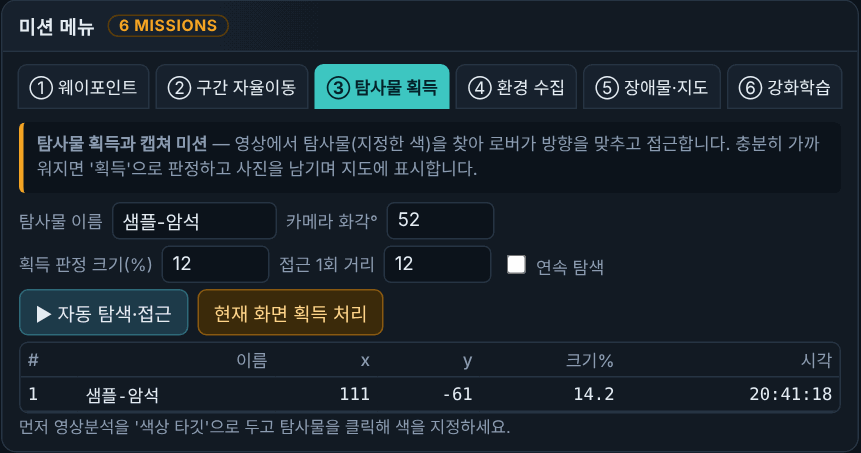
▲ ③ 탐사물 획득 탭 — 탐사물 1개 획득

영상에서 지정한 색의 탐사물을 찾아 방향을 맞추고 접근합니다. 충분히 가까워지면 '획득'으로 판정해 사진을 찍고 지도에 ★로 표시합니다.

| 요소 | 사용방법 |
|---|---|
| **탐사물 이름** | 기록·사진·지도에 붙을 이름. (기본: 샘플-암석) |
| **카메라 화각°** | 화면 좌우 어긋남을 회전각으로 바꿀 때 씁니다. ESP32-CAM 기본 52°. |
| **획득 판정 크기(%)** | 탐사물이 화면의 이 비율 이상을 차지하면 획득. 클수록 더 가까이 갑니다. |
| **접근 1회 거리** | 한 번에 다가가는 거리(cm). |
| **☐ 연속 탐색** | 하나를 얻으면 뒤로 15cm, 120° 돌아 다음 탐사물을 찾습니다. |
| **[▶ 자동 탐색·접근]** | 미션 시작. |
| **[현재 화면 획득 처리]** | 지금 보이는 것을 수동으로 획득 처리(사진 + 기록). |
| **표** | 번호, 이름, 추정 x·y, 크기 %, 시각. |

**순서**
1. 영상을 연결하고 분석을 `색상 타깃` 으로 둡니다.
2. 영상에서 **탐사물을 클릭**해 색을 지정합니다. (안 하면 기본 주황색으로 찾습니다)
3. 노란 사각형이 탐사물에만 잡히도록 허용 H±·최소 S 를 조정합니다.
4. **[▶ 자동 탐색·접근]**.

**로버 동작**: 안 보이면 30°씩 돌며 찾음 → 보이면 화면 중심에 오도록 회전 → 접근 1회 거리만큼 전진 → 판정 크기에 도달하면 획득.
한 바퀴(360°) 돌아도 없거나 5분이 지나면 멈춥니다.

---

### ④ 환경 수집 — 환경데이터 수집 미션

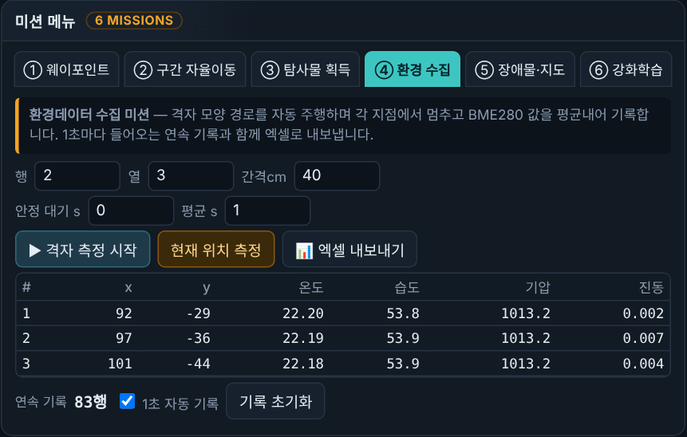
▲ ④ 환경 수집 탭 — 3개 지점 측정

격자 모양 경로를 자동 주행하며 각 지점에서 멈춰 BME280 값을 평균 내어 기록합니다. 1초마다의 연속 기록과 함께 엑셀로 내보냅니다.

| 요소 | 사용방법 |
|---|---|
| **행 / 열** | 격자 크기 (각 1~10). 예) 2×3 = 6지점. |
| **간격cm** | 지점 사이 거리. |
| **안정 대기 s** | 도착 후 센서가 안정될 때까지 기다리는 시간. |
| **평균 s** | 평균을 낼 측정 시간. |
| **[▶ 격자 측정 시작]** | 미션 시작. 한 줄 끝에서 90° → 간격만큼 이동 → 90° 로 지그재그. |
| **[현재 위치 측정]** | 지금 자리에서 한 지점만 측정. |
| **[📊 엑셀 내보내기]** | 모든 탐사 데이터를 엑셀 파일 하나로 저장 ([9. 저장되는 파일](#9-저장되는-파일) 참고). |
| **표** | 번호, x, y, 온도, 습도, 기압, 진동. |
| **연속 기록 n행** | 1초마다 쌓이는 환경 기록 수. |
| **☑ 1초 자동 기록** | 끄면 연속 기록을 멈춥니다. |
| **[기록 초기화]** | 연속 기록만 지웁니다. |

> 측정 지점은 지도에 온도 색점으로 표시됩니다. 이동 중 충돌하면 그 자리에 장애물을 표시하고 측정을 이어갑니다.

---

### ⑤ 장애물·지도 — 장애물 주행과 주변 지도 작성 미션

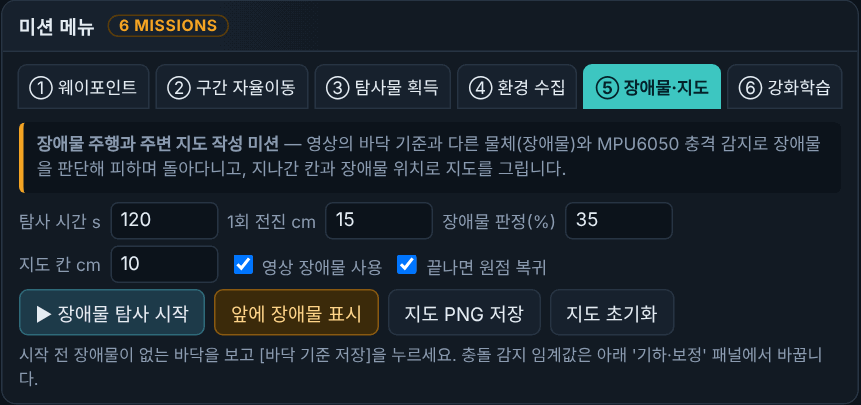
▲ ⑤ 장애물·지도 탭

영상(바닥과 다른 물체), MPU6050 충격 감지, (있으면) 초음파로 장애물을 판단해 피하며 돌아다니고, 지나간 칸과 장애물로 지도를 그립니다.

| 요소 | 사용방법 |
|---|---|
| **탐사 시간 s** | 자율 탐사를 할 시간. |
| **1회 전진 cm** | 한 번에 나아가는 거리. |
| **장애물 판정(%)** | 바닥 영역 중 이 비율 이상이 바닥과 다르면 장애물. |
| **지도 칸 cm** | 방문한 칸을 세는 격자 크기. |
| **☑ 영상 장애물 사용** | 끄면 충돌·초음파로만 판단합니다. |
| **☑ 끝나면 원점 복귀** | 탐사 시간이 끝나면 (0,0)으로 돌아옵니다. |
| **[▶ 장애물 탐사 시작]** | 미션 시작. |
| **[앞에 장애물 표시]** | 로버 앞 25cm 에 장애물을 수동으로 표시. |
| **[지도 PNG 저장]** | 지금 지도를 그림 파일로 저장. |
| **[지도 초기화]** | 경로·장애물·방문 칸을 지웁니다. |

**순서**
1. 장애물이 없는 바닥을 비추고 영상 카드의 **[바닥 기준 저장]**. (안 하면 시작할 때 자동 저장)
2. 영상 위 사다리꼴이 초록색인지 확인. 바닥인데 빨간색이면 장애물 민감도를 낮춥니다.
3. **[▶ 장애물 탐사 시작]**.

**로버 동작**: 앞이 비었으면 전진 → 영상/초음파(20cm 이내)로 장애물이면 지도에 ✕ 표시 후 60~120° 회전 → 부딪히면 10cm 후진 후 90~150° 회전. 세 번마다 도는 방향을 바꿔 한쪽으로만 맴돌지 않게 합니다.

> 충돌 감지 임계값은 **기하·보정 ▸ 충돌감지 g** 에서 바꿉니다.

---

### ⑥ 강화학습 — 박스를 돌아 제자리로

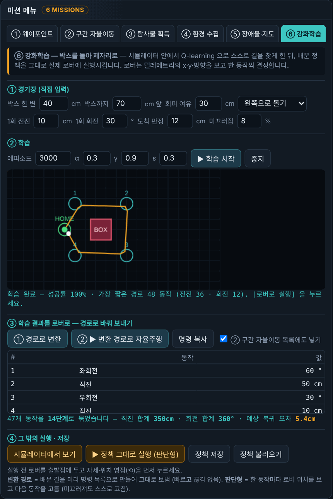
▲ ⑥ 강화학습 탭 — 학습 완료 후 경로로 변환한 상태

시뮬레이터 안에서 Q-learning 으로 박스를 한 바퀴 돌아 출발점에 돌아오는 길을 스스로 배우게 한 뒤, 배운 정책을 실제 로버에서 실행합니다.

**① 경기장 (직접 입력)**

| 요소 | 뜻 |
|---|---|
| 박스 한 변 (cm) | 돌아야 할 박스 크기 |
| 박스까지 (cm 앞) | 출발점에서 박스 중심까지 거리 |
| 회피 여유 (cm) | 박스에서 떨어져 지나갈 거리 |
| 왼쪽으로 돌기 / 오른쪽으로 돌기 | 도는 방향 |
| 1회 전진 (cm) / 1회 회전 (°) | 로버가 한 번에 할 수 있는 동작 크기 (동작은 전진·좌회전·우회전 3가지) |
| 도착 판정 (cm) | 관문에 이만큼 가까워지면 통과 |
| 미끄러짐 (%) | 학습·평가 때 넣는 동작 오차 |

그림에서 **파란 원 = 지나야 할 관문(박스 네 모서리 바깥)**, **초록 원 = 출발점**입니다. 관문 4개 + 출발점 = 5단계를 통과하면 성공.

**② 학습**

| 요소 | 뜻 |
|---|---|
| 에피소드 | 연습 횟수 (기본 4000) |
| α | 학습률 — 새 경험을 얼마나 반영할지 |
| γ | 할인율 — 먼 미래 보상을 얼마나 중시할지 |
| ε | 탐험률 — 무작위로 시도해 볼 비율 |
| [▶ 학습 시작] / [중지] | 학습 시작·중단. 끝나면 미끄러짐을 넣어 50번 시험해 **성공률**을 알려 줍니다. 50% 이상이면 완료. |

**③ 학습 결과를 로버로 — 경로로 바꿔 보내기** (권장)

| 버튼 | 사용방법 |
|---|---|
| **[① 경로로 변환]** | 배운 동작을 묶어 "직진 몇 cm · 회전 몇 °" 목록으로 만듭니다. 여러 번 시험해 성공한 것 중 가장 짧은 길을 고릅니다. |
| **[② ▶ 변환 경로로 자율주행]** | 그 목록을 로버에 차례로 보냅니다. 끝나면 출발점에서 몇 cm 떨어졌는지 알려 줍니다. |
| **[명령 복사]** | 명령 목록을 글자로 복사합니다. |
| **☑ ② 구간 자율이동 목록에도 넣기** | 변환한 경로를 ② 미션 경로에도 넣어 수정·반복 실행할 수 있게 합니다. |

**④ 그 밖의 실행 · 저장**

| 버튼 | 사용방법 |
|---|---|
| **[시뮬레이터에서 보기]** | 배운 정책대로 그림 안에서 움직여 봅니다. |
| **[▶ 정책 그대로 실행 (판단형)]** | 한 동작마다 로버 위치를 보고 다음 동작을 고릅니다. 느리지만 미끄러져도 스스로 고칩니다. 같은 자리를 맴돌면 한 번 흔들어 빠져나옵니다. |
| **[정책 저장] / [정책 불러오기]** | 학습 결과를 `PUMPKIN_RL_policy_날짜.json` 으로 저장·불러오기. 경기장 값도 함께 복원됩니다. |

> 실행 전 로버를 출발점에 두고 **[⟲ 자세 영점]** 을 먼저 누르세요. 로버 크기(기하·보정의 윤거·축거)만큼 박스에서 더 떨어지도록 자동 계산됩니다.

---

## 8. 키보드 단축키

| 키 | 기능 | 비고 |
|---|---|---|
| `Space` | 비상정지 | 글자 입력칸에서는 동작 안 함 |
| `Esc` | 비상정지 | **어디서나 항상** 작동 |
| `W` `A` `S` `D` / 방향키 | 수동 주행 | 누르고 있는 동안만 |
| `C` | 캡쳐 | |
| `P` | 웨이포인트 기록 | |
| `1` `2` `3` `4` | 화면 전환 (운용·지도·주행·보정·데이터·로그) | |
| `Enter` | 직접 명령 보내기 | 통신 로그 입력칸에서 |

숫자·글자를 입력하는 칸에 커서가 있으면 주행·캡쳐·화면 전환 키는 무시됩니다. 조종하려면 빈 곳을 한 번 클릭하세요.

---

## 9. 저장되는 파일

| 파일 | 만드는 곳 | 내용 |
|---|---|---|
| `PUMPKIN_탐사데이터_날짜_시각.xlsx` | ④ [📊 엑셀 내보내기] | 시트 6개 (아래 표) |
| `PUMPKIN_날짜_시각_번호.jpg` | 캡쳐 썸네일 클릭 / [캡쳐 전체 저장] | 캡쳐 사진 |
| `PUMPKIN_지도_날짜.png` | ⑤ [지도 PNG 저장] | 탐사 지도 그림 |
| `PUMPKIN_RL_policy_날짜.json` | ⑥ [정책 저장] | 강화학습 정책 |

**엑셀 시트 구성**

| 시트 | 열 |
|---|---|
| 환경데이터(1초) | 시각, 미션, X, Y, 방향, 온도, 습도, 기압, 상대고도, 지면진동, Roll, Pitch, 배터리 |
| 측정지점 | 번호, 시각, X, Y, 온도평균, 습도평균, 기압평균, 진동평균, 표본수 |
| 웨이포인트 | WP, X, Y, 방향, 시각 |
| 장애물 | 번호, X, Y, 판단 근거(영상·초음파·충돌·수동), 시각 |
| 탐사물 | 번호, 이름, X, Y, 영상크기, 시각 |
| 캡쳐목록 | 캡쳐, 구분, 미션, 시각, X, Y, 방향, 온도, 습도, 기압, 파일명 |

> 엑셀 라이브러리가 없을 때는 자동으로 CSV(한글 깨짐 방지) 로 저장됩니다.

**브라우저에 기억되는 값** (다시 열어도 유지): 카메라 IP, 마지막 화면, 촘촘히 설정, 윤거·축거·휠 직경, ② 경로 단계, 거리→시간 환산값, ROLL·PITCH 반전, 시뮬레이션 보정값.
**기억되지 않는 값** (새로고침하면 사라짐): 캡쳐 사진, 환경 기록, 웨이포인트, 장애물, 탐사물, 학습 정책 → **끝나기 전에 꼭 저장하세요.**

---

## 10. 처음 한 번 하는 보정 순서

로버를 새로 조립했거나 바퀴·배터리를 바꿨을 때 **[주행·보정] 화면(3번)** 에서 순서대로 합니다.

1. **방향 확인** — 수동으로 왼쪽 회전 → Heading 이 늘어나는지 확인. 줄어들면 **[↻ YAW 반전]**.
2. **기울기 확인** — 로버 앞을 들면 Pitch, 왼쪽을 들면 Roll 이 바뀌는지 확인. 반대면 ROLL/PITCH 반전.
3. **치수 입력** — 윤거 T, 축거 L, 휠 직경 Ø 를 재서 넣고 **[로버에 입력·계산]**.
4. **데드밴드** — 오도메트리 주행 → 시간주행에서 PWM 을 낮춰 가며 겨우 움직이는 값을 찾아 데드밴드에 저장.
5. **속도 보정** — 출발점에 테이프 → **[속도보정: 2초 직진]** 두 번 → 잰 거리 입력 → **[보정값 저장]**.
   (또는 거리→시간 환산 카드에서 ① 속도 재기)
6. **스키드 보정** — 주변을 비우고 **[스키드계수 자동보정]** 두 번.
7. **확인** — `D,50` 과 `A,90` 을 보내 실제로 50cm, 90° 가 나오는지 봅니다. 오차가 크면 5~6번을 다시.
8. **충돌감지** — 손으로 살짝 쳐서 충돌이 잡히는지, 그냥 달릴 때 잘못 잡히지 않는지 보고 충돌감지 g 를 정합니다.

> 바닥 재질(타일·카펫·흙)이 바뀌면 5~6번을 다시 하는 것이 좋습니다.

---

## 11. 문제 해결

| 증상 | 확인할 것 |
|---|---|
| [로버 연결] 을 눌러도 아무것도 안 뜸 | Chrome/Edge 인지, 노트북 블루투스가 켜져 있는지. 로그에 "Web Bluetooth 미지원" 이 있으면 브라우저 문제. |
| 목록에 로버가 없음 | **☑ 모든 장치** 체크 후 다시. 다른 노트북·폰이 이미 연결 중이면 HM-10은 하나만 붙습니다. |
| 텔레메트리가 빨간 `n s 전` | 거리가 멀거나 배터리 부족. 연결 해제 후 다시 연결. |
| 영상이 안 나옴 | 노트북 Wi-Fi 가 `PUMPKIN-CAM-팀번호` 인지, IP 가 `192.168.4.1` 인지. ESP32-CAM 은 한 번에 1대만 접속됩니다 (다른 노트북 연결 해제). |
| 영상이 끊김 | 해상도 QVGA, fps 10~12 로 낮추기. 옆 팀과 Wi-Fi 채널이 겹치지 않는지. |
| "영상분석 불가 · CORS" | ESP32-CAM 에 최신 CAM 코드를 올립니다. |
| 탐사물을 못 찾음 | 탐사물을 다시 클릭해 색 지정, 허용 H± 늘리기, 조명 확인(밝기 분석 모드). |
| 바닥인데 장애물로 판단 | [바닥 기준 저장] 다시, 장애물 민감도 낮추기, 장애물 판정(%) 올리기. |
| 미션이 "충돌 감지로 멈췄습니다" 만 반복 | 충돌감지 g 를 1.0~1.2 로 올리거나 ② 에서 ☐ 충돌 시 중단. |
| "완료 신호 F 가 오지 않아 멈췄습니다" | 통신 로그에서 `▶` 보낸 명령과 `◀` 받은 줄 비교. 나노 펌웨어가 최신인지 확인. |
| 회전 방향이 반대로 돌아감 | [↻ YAW 반전]. |
| 거리가 계속 짧거나 김 | 속도 보정 다시, 또는 거리→시간 환산 미세조정. 배터리 전압이 떨어지면 속도도 떨어집니다. |
| MPU6050 없음 / BME280 없음 | 로그에 나온 배선 안내 확인 → 고친 뒤 [센서 다시 찾기]. 하나를 빼고 찾아 보면 버스를 막는 센서를 찾을 수 있습니다. |
| `N,I2C RECOVER` 가 자주 찍힘 | 센서 배선이 흔들리거나 모터 잡음이 큼. 접지 정리, 모터 콘덴서, I2C 선 짧게. |
| 키보드로 조종이 안 됨 | 숫자 입력칸에 커서가 있는 상태. 빈 곳을 클릭하세요. |
| [⟲ 초기화] 후 좌표가 0 이 안 됨 | 로그에 "원점 신호(Z)에 응답하지 않습니다" → 연결 상태 확인 후 다시. |

---

## 12. 부록: BLE 명령·텔레메트리 형식

통신 로그의 **직접 명령** 칸에서 그대로 쓸 수 있습니다. 한 줄에 명령 하나, 쉼표로 구분합니다.

### GCS → 로버 명령

| 명령 | 형식 | 뜻 |
|---|---|---|
| M | `M,왼쪽PWM,오른쪽PWM` | 수동 주행 (−255~255). 0.7초 안에 다시 안 오면 정지 |
| S | `S` | 정지 |
| T | `T,방향(F/B/L/R),시간ms,PWM` | 시간주행 |
| D | `D,거리cm` | 직진 (음수 = 후진) |
| A | `A,각도°` | 제자리 회전 (양수 = 왼쪽) |
| R | `R,반경cm,각도°` | 원호 주행 |
| G | `G,윤거mm,축거mm` | 기하 입력·회전반경 계산 |
| X | `X` | 스키드계수 자동보정 |
| V | `V,PWM,거리cm,시간ms` | 속도 보정값 저장 |
| P | `P,PWM` | 자율 기본 PWM |
| W | `W,데드밴드,최대` | PWM 범위 |
| Y | `Y,1` 또는 `Y,-1` | YAW 부호 |
| J | `J,g×100` | 충돌감지 임계값 (0 = 끔) |
| Z | `Z` | 위치 원점 |
| C | `C` | 자이로 재보정 |
| Q | `Q` | 설정값(G 줄)·센서 상태·I2C 복구 횟수 요청 |
| U | `U` | I2C 센서 다시 찾기 |
| H | `H` | 연결 확인 |

### 로버 → GCS 응답·텔레메트리

| 줄 | 형식 | 뜻 |
|---|---|---|
| I | `I,roll×10,pitch×10,yaw×10,x×10,y×10,모드[,초음파cm]` | 자세·위치 |
| E | `E,온도×100,습도×10,기압×10,고도×10,진동×100,배터리×100` | 환경 |
| K | `K,명령` | 명령 시작 |
| F | `F,명령` | 명령 완료 |
| B | `B,x×10,y×10` | 충돌 감지 위치 |
| G | `G,T,L,χ×1000,B×10,쓸림×10,속도×10,보정PWM,데드밴드,최대,기본PWM,YAW부호` | 기하·보정값 |
| U | `U,MPU주소,칩ID,BME주소,찾은주소…` (16진수) | 센서 상태 |
| N | `N,메시지` | 알림 (예: `N,I2C RECOVER #1 mpu-reset bus=OK ...`) |

모드 번호: 0 IDLE · 1 MANUAL · 2 TIMED · 3 DIST · 4 TURN · 5 ARC · 6 CALIB

---

PUMPKIN IDEA FACTORY MAKERSPACE · Student Rover Challenge Korea
